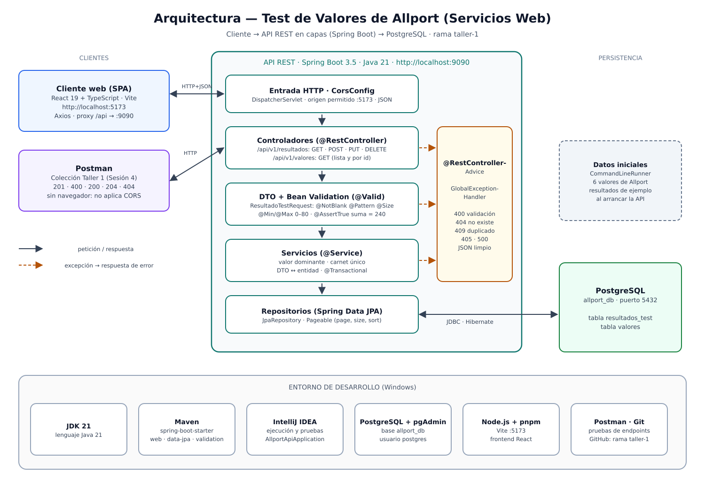

# Taller #1 — Configuración del entorno Spring Boot y diagrama de arquitectura

**Asignatura:** Servicios Web (SIS0421, Grupo 2) · **Sesión 4:** escritura, validación y manejo de errores en Spring Boot
**Proyecto:** Test de Valores de Allport (rama `taller-1` de este repositorio)

## 1. Propuesta de arquitectura



El sistema registra y consulta los resultados del Test de Valores de Allport que aplica la universidad. Se organiza en tres partes que se comunican por servicios web REST con JSON:

| Parte | Tecnología | Responsabilidad |
|---|---|---|
| Cliente web | React 19 + TypeScript (Vite, puerto 5173) | Muestra los resultados, filtra y registra nuevos tests llamando a la API con Axios. |
| API REST | Spring Boot 3.5, Java 21 (puerto 9090) | Expone `/api/v1/resultados` y `/api/v1/valores`, valida los datos y aplica las reglas del test. |
| Base de datos | PostgreSQL (`allport_db`, puerto 5432) | Guarda las tablas `resultados_test` y `valores`. |

### Capas de la API

1. **Entrada HTTP y CORS** (`CorsConfig`): solo el frontend en `http://localhost:5173` puede llamar a `/api/**` desde el navegador.
2. **Controladores** (`ResultadoTestController`, `ValorController`): reciben la petición, activan `@Valid` y responden con `ResponseEntity` y el código HTTP correcto. No tienen lógica de negocio.
3. **DTO y validación** (`ResultadoTestRequest`): el cliente nunca envía la entidad. El DTO declara las reglas con Jakarta Validation: `@NotBlank`, `@Pattern` (carnet de 5 a 20 dígitos), `@Size`, `@Min`/`@Max` (0 a 80) y `@AssertTrue` (los seis puntajes suman 240).
4. **Servicios** (`ResultadoTestService`): convierten DTO ↔ entidad, calculan el valor dominante, impiden carnets repetidos y manejan las transacciones.
5. **Repositorios** (Spring Data JPA): acceso a PostgreSQL con paginación (`page`, `size`, `sort`) resuelta por la base de datos.
6. **Manejo global de errores** (`GlobalExceptionHandler`, `@RestControllerAdvice`): un solo lugar convierte las excepciones en un JSON estable (`timestamp`, `status`, `error`, `message`, `path`, `errores`). Nunca se devuelve el stack trace ni detalles de SQL.

### Contrato de la API

| Método y ruta | Éxito | Errores controlados |
|---|---|---|
| `GET /api/v1/resultados?page&size&sort&carrera` | 200 página de resultados | 400 parámetro inválido |
| `GET /api/v1/resultados/{id}` | 200 | 404 no existe · 400 id mal formado |
| `POST /api/v1/resultados` | 201 + cabecera `Location` | 400 validación · 409 carnet repetido |
| `PUT /api/v1/resultados/{id}` | 200 recurso actualizado | 400 validación · 404 no existe · 409 carnet de otro registro |
| `DELETE /api/v1/resultados/{id}` | 204 sin cuerpo | 404 no existe |
| `GET /api/v1/valores` y `/{id}` | 200 | 404 no existe |

Las rutas que no existen responden 404 y los métodos no permitidos 405, en el mismo formato JSON.

## 2. Configuración del entorno

| Herramienta | Uso en el proyecto |
|---|---|
| JDK 21 | Versión de Java del `pom.xml` (`<java.version>21</java.version>`). |
| Maven | Dependencias: `spring-boot-starter-web`, `-data-jpa`, `-validation`, driver `postgresql`; `h2` y `spring-boot-starter-test` para las pruebas. |
| IntelliJ IDEA | Abrir la carpeta `backend` como proyecto Maven y ejecutar `AllportApiApplication`. |
| PostgreSQL + pgAdmin | Crear la base `allport_db`. Hibernate crea las tablas (`ddl-auto=update`) y `DatosIniciales` carga los 6 valores y resultados de ejemplo. |
| Postman | Probar los endpoints con la colección `backend/postman/Taller1_Sesion4_Escritura_Validacion_Errores.postman_collection.json`. |
| Node.js + pnpm | Ejecutar el frontend (`pnpm install`, `pnpm dev`). |
| Git y GitHub | Control de versiones; este taller vive en la rama `taller-1`. |

### Pasos para levantar el proyecto

```bash
git clone https://github.com/Rrodrovan/servicios-web-sesion8-dto-paginacion-allport.git
cd servicios-web-sesion8-dto-paginacion-allport
git checkout taller-1
```

1. En pgAdmin (o `psql`) crear la base: `CREATE DATABASE allport_db;`
2. Revisar `backend/src/main/resources/application.properties`. La conexión se puede cambiar sin tocar el código con las variables de entorno `DB_URL`, `DB_USER` y `DB_PASSWORD`.
3. En IntelliJ abrir `backend`, esperar a que Maven descargue las dependencias y ejecutar `AllportApiApplication`. La API queda en `http://localhost:9090`.
4. Pruebas automáticas: panel Maven → Lifecycle → `test` (usa H2 en memoria con el perfil `test`, no toca PostgreSQL).
5. En Postman importar la colección del Taller 1 y ejecutarla en orden con el Collection Runner.
6. (Opcional) Frontend: en la raíz, `pnpm install` y `pnpm dev`, y abrir `http://localhost:5173`.

## 3. Checklist de la Sesión 4 en Postman

| # | Petición | Resultado esperado |
|---|---|---|
| 1 | POST válido | 201 Created + cabecera `Location` |
| 2 | POST inválido | 400 con un mensaje por campo |
| 3 | PUT sobre id existente | 200 OK con el valor dominante recalculado |
| 4 | GET del recurso actualizado | 200 OK |
| 5 | DELETE | 204 No Content |
| 6 | GET de id inexistente | 404 con JSON limpio |
| 7 | PUT sobre id inexistente | 404 |
| 8 | GET con id mal formado | 400 |

## 4. Evidencias

Las capturas de Postman y del entorno se agregan en la carpeta `evidencias/`.
